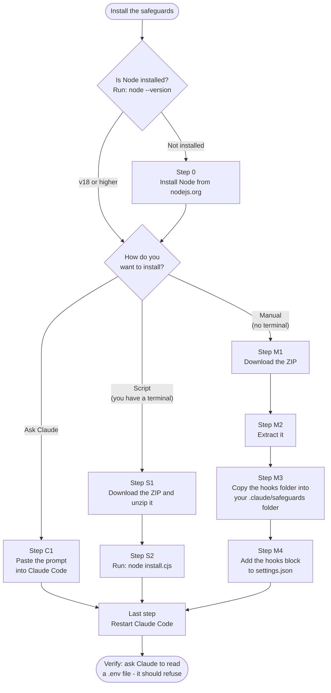

# Claude Code Safeguards

1. **Never access a production Salesforce org**, even read-only.
2. **Make no lasting changes to any org**: people deploy and change data.
3. **Don't send secrets or personal data to Anthropic**, whether through a
   prompt or through a file or command result Claude reads.
4. **Don't run destructive local commands** that wipe disks, delete system
   folders, or pipe a download into a shell.

They guard against accidents (a rushed request, a forgotten rule), not
against someone determined to get around them. They act only on what Claude
does: commands you type in your own terminal are never affected.

Everything is **pure Node** — no dependencies, no build step, the same files on
macOS, Linux, and Windows.

## Install

There are three ways in. Pick the one that matches you:

- **Ask Claude** — paste one prompt into Claude Code and let it do the work.
  It also tells you whether you already have the safeguards.
- **Script install** — you're comfortable in a terminal. Three commands.
- **Manual install** — no terminal at all. Download, extract, drag a folder,
  paste a block of text into a settings file.

All three end up in the same place. None of them needs git. All of them need
**Node**.



Each step below has instructions for macOS, Windows and Linux.

<details>
<summary>Same chart, as plain text (if the diagram above doesn't render)</summary>

```text
                    Install the safeguards
                              |
                 Is Node installed?  (node --version)
                     /                        \
              v18 or higher                not installed
                    |                             |
                    |              STEP 0: install Node from nodejs.org
                    |                             |
                    +--------------+--------------+
                                   |
                      How do you want to install?
             /                     |                      \
     Ask Claude          Script (terminal)        Manual (no terminal)
          |                        |                       |
  C1: paste the prompt   S1: download ZIP, unzip   M1: download ZIP
      into Claude Code             |                       |
          |              S2: node install.cjs     M2: extract it
          |                        |                       |
          |                        |              M3: copy the hooks folder
          |                        |                  into .claude/safeguards
          |                        |                       |
          |                        |              M4: add the hooks block
          |                        |                  to settings.json
          |                        |                       |
          +------------------------+-----------------------+
                                   |
                    LAST STEP: restart Claude Code
                                   |
               VERIFY: ask Claude to read a .env file
                      - it should refuse
```

</details>

### Step 0: Node (every path)

The hooks run on Node 18 or newer. If you installed Claude Code with `npm`,
you already have it.

**Check:** open a terminal — Terminal.app on macOS, PowerShell on Windows —
and run:

```bash
node --version
```

A version like `v20.11.1` means you're set — skip the rest of this step.
`command not found` (or `not recognized`) means Node isn't installed, or isn't on
your PATH.

**Install it:** download it from
**<https://nodejs.org/en/download/current>** and pick the build for your OS:

| OS | File to download | Then |
|----|------------------|------|
| **macOS** | the `.pkg` installer — **ARM64** for Apple Silicon (M1/M2/M3/M4), **x64** for an Intel Mac | Double-click it, click through, then **close and reopen your terminal** |
| **Windows** | the `.msi` installer (`x64`) | Double-click it, click through — leave "Add to PATH" checked — then **close and reopen PowerShell** |
| **Linux** | your distro's package (`sudo apt install nodejs`, `sudo dnf install nodejs`), or the `.tar.xz` from the same page | Reopen your terminal |

The macOS and Windows installers ask for an administrator password; ask IT if
you don't have one. Nothing else here needs admin rights.

Run `node --version` again to confirm before you carry on.

---

## Ask Claude to install it

One prompt, no terminal work of your own. It reports what you already have, and
installs only what's missing.

### Step C1: Paste this prompt into Claude Code

```text
Check whether the CRMF Claude Code safeguards are installed on this machine,
and install them from the repo if they aren't.

CHECK
1. Run `node --version`. If Node is missing or older than v18, stop and tell me
   - do not try to install Node yourself.
2. Look in ~/.claude/settings.json (Windows: %USERPROFILE%\.claude\settings.json)
   for hook entries whose command contains "guard.cjs", under each of
   PreToolUse, UserPromptSubmit and PostToolUse.
3. Check that the file those entries point at actually exists (normally
   ~/.claude/safeguards/hooks/guard.cjs), and that hooks/lib/ sits next to it.
4. Report which of the three events are wired and whether the files are there.
   Do not print the contents of settings.json.

IF ALL THREE ARE WIRED AND THE FILES EXIST
Stop. Tell me I'm covered, and give me the modified date of guard.cjs so I know
how old my copy is.

IF ANYTHING IS MISSING
1. Download https://github.com/thecrmfirm/claude_safeguards/archive/refs/heads/main.zip
   into a temp folder and extract it (use the extraction tool that fits this OS;
   `git clone https://github.com/thecrmfirm/claude_safeguards.git` is fine if git
   is installed). Never pipe a download into a shell.
2. From the extracted folder, run `node install.cjs --dry-run`, show me the
   result, then run `node install.cjs`.
3. Confirm afterwards that ~/.claude/safeguards/hooks/guard.cjs exists and all
   three hook entries are in settings.json.
4. Tell me to restart Claude Code - or type /hooks and press Esc - since hooks
   are only loaded at startup.
```

What to expect:

- **Approve the permission prompts.** Claude asks before downloading and before
  running the installer, which writes `~/.claude/settings.json` and copies files
  into `~/.claude/safeguards/`.
- **Restart afterwards even though Claude just installed them.** The hooks load
  at startup, so they are not active in the session that installed them.
- **It checks registration, not freshness.** If all three hook entries are
  already there, it stops and reports the date of your copy. To pull a newer
  version, follow [Updating](#updating).

To keep it at hand, save the prompt as `~/.claude/commands/check-safeguards.md`
and run it in any session by typing `/check-safeguards`.

---

## Script install

For anyone comfortable with a terminal. No git required — you download a ZIP.

### Step S1: Download and unzip

Go to **<https://github.com/thecrmfirm/claude_safeguards>**, click the green
**Code** button, choose **Download ZIP**, and unzip it. Or do it from the
terminal:

**macOS / Linux**

```bash
cd ~/Downloads
curl -L -o claude_safeguards.zip https://github.com/thecrmfirm/claude_safeguards/archive/refs/heads/main.zip
unzip claude_safeguards.zip
cd claude_safeguards-main
```

**Windows (PowerShell)**

```powershell
cd $HOME\Downloads
Invoke-WebRequest -Uri https://github.com/thecrmfirm/claude_safeguards/archive/refs/heads/main.zip -OutFile claude_safeguards.zip
Expand-Archive claude_safeguards.zip -DestinationPath .
cd claude_safeguards-main
```

With git installed, `git clone https://github.com/thecrmfirm/claude_safeguards.git`
works just as well and makes updating one command.

There is no `npm install` — there are no dependencies.

### Step S2: Run the installer

Run this **from the unzipped folder** (the one holding `install.cjs`). It
copies the hooks to `~/.claude/safeguards/hooks/` and wires them into
`~/.claude/settings.json`, first backing up your existing settings to a
timestamped `settings.json.bak-YYYYMMDD-HHMMSS`. Your other settings and hooks
are kept. If `settings.json` isn't valid JSON, the installer stops and changes
nothing:

```bash
node install.cjs --dry-run   # optional: print the resulting settings, write nothing
node install.cjs
```

The same two commands work in PowerShell on Windows.

Now skip to [Last step: restart Claude Code](#last-step-restart-claude-code).

---

## Manual install

No terminal, no git, no commands — you download a file, drag a folder, and
paste some text. Node still has to be installed
([Step 0](#step-0-node-every-path)).

### Step M1: Download the ZIP

1. Open **<https://github.com/thecrmfirm/claude_safeguards>** in your browser.
2. Click the green **Code** button near the top right.
3. Choose **Download ZIP**.
4. It lands in your **Downloads** folder as `claude_safeguards-main.zip`.

### Step M2: Extract it

- **macOS:** double-click the ZIP in Finder. You get a folder called
  `claude_safeguards-main`.
- **Windows:** right-click the ZIP in File Explorer → **Extract All…** →
  **Extract**. You get a folder called `claude_safeguards-main`.

Open that folder. Inside it is a folder named **`hooks`** — that's the one
you're going to copy. (If you see another `claude_safeguards-main` inside, open
it; `hooks` is one level down.)

### Step M3: Find your `.claude` folder and copy `hooks` into it

Your `.claude` folder is in your **home folder** and is hidden by default.
Open it through the address box rather than by browsing:

**macOS**

1. Click the desktop (so Finder is in front).
2. In the menu bar: **Go → Go to Folder…** (or press **⇧ ⌘ G**).
3. Type `~/.claude/safeguards/` and press **Return**.
   - If Finder says the folder doesn't exist, type `~/.claude` instead, press
     Return, and create a new folder inside it named **`safeguards`** (**File →
     New Folder**, or **⇧ ⌘ N**). If `~/.claude` itself doesn't exist, launch
     Claude Code once — it creates it — then try again.
4. Drag the **`hooks`** folder from the unzipped download into
   `safeguards`, so you end up with
   **`~/.claude/safeguards/hooks/guard.cjs`**.

**Windows**

1. Open **File Explorer**.
2. Click the **address bar** at the top (or press **Alt + D**) and type
   `%USERPROFILE%\.claude\safeguards` then press **Enter**.
   - If Explorer says it can't find it, type `%USERPROFILE%\.claude` instead,
     press Enter, and create a new folder named **`safeguards`** (right-click
     → **New → Folder**). If `.claude` itself doesn't exist, launch Claude Code
     once — it creates it — then try again.
3. Copy the **`hooks`** folder from the extracted download and paste it into
   `safeguards`, so you end up with
   **`C:\Users\<you>\.claude\safeguards\hooks\guard.cjs`**.

**Linux**

In Files/Nautilus press **Ctrl + L** and type `~/.claude/safeguards`, then copy
`hooks` in. Show hidden files with **Ctrl + H** if you prefer to browse.

> **Write down the full path.** You need it in the next step. On macOS,
> right-click the `hooks` folder → hold **Option** → **Copy "hooks" as
> Pathname**. On Windows, click the Explorer address bar while inside `hooks`
> and copy the text (e.g. `C:\Users\jsmith\.claude\safeguards\hooks`).

### Step M4: Tell Claude Code to use the hooks

Claude Code reads its settings from a file called **`settings.json`** in the
same `.claude` folder: `~/.claude/settings.json` (macOS/Linux) or
`%USERPROFILE%\.claude\settings.json` (Windows).

1. **Back it up first if it already exists.** Copy and paste the file in place
   — you'll get `settings copy.json` / `settings - Copy.json`. If it's not
   there, you'll create it in a moment.
2. Open `settings.json` in a plain-text editor — **TextEdit** on macOS
   (**Format → Make Plain Text** if it opens as rich text), **Notepad** on
   Windows, or VS Code if you have it. Not Word.
3. If the file is **empty or missing**, paste this in whole. If it already has
   content, paste only the `"hooks": { … }` part as a new top-level key, and
   make sure every entry is separated by a comma:

   ```json
   {
     "hooks": {
       "PreToolUse": [
         {
           "matcher": "Bash|BashOutput|Read|Edit|Write|MultiEdit|NotebookEdit|NotebookRead|WebFetch|Grep",
           "hooks": [
             { "type": "command", "command": "node \"/Users/YOURNAME/.claude/safeguards/hooks/guard.cjs\"" }
           ]
         }
       ],
       "UserPromptSubmit": [
         {
           "hooks": [
             { "type": "command", "command": "node \"/Users/YOURNAME/.claude/safeguards/hooks/guard.cjs\"" }
           ]
         }
       ],
       "PostToolUse": [
         {
           "matcher": "Bash|Read|Grep|WebFetch",
           "hooks": [
             { "type": "command", "command": "node \"/Users/YOURNAME/.claude/safeguards/hooks/guard.cjs\"" }
           ]
         }
       ]
     }
   }
   ```

4. **Replace all three paths** with the path you copied in Step M3, ending in
   `/guard.cjs`:
   - **macOS:** `/Users/YOURNAME/.claude/safeguards/hooks/guard.cjs` — swap
     `YOURNAME` for your short user name (it's in the pathname you copied).
   - **Linux:** `/home/YOURNAME/.claude/safeguards/hooks/guard.cjs`.
   - **Windows:** use **forward slashes** —
     `C:/Users/YOURNAME/.claude/safeguards/hooks/guard.cjs`. A single backslash
     breaks the file; if you use backslashes, double every one
     (`C:\\Users\\…`).
5. Save the file. Keep the name exactly `settings.json` — Notepad likes to add
   `.txt`; choose **Save as type → All Files** if it does.

[settings.sample.json](settings.sample.json) in the download has the same
block, but written for a *project* install — if you copy from it, you still
have to replace `$CLAUDE_PROJECT_DIR/hooks` with your full path.

---

## Last step: restart Claude Code

Settings are read at startup. Either quit and reopen Claude Code, or, in a
session that's already open, type `/hooks` and press Enter. A menu listing your
hooks pops up. **You don't need to do anything in it**: opening it is what
reloads the settings. Press **Esc** to close it and carry on.

## Verify

In Claude Code, try two things:

- Ask it to read a `.env` file: the tool call should be denied with a reason.
- Ask it to deploy something to one of your sandboxes (without `--dry-run`):
  it should refuse and give you the command to run yourself.

If you have a terminal, the full test suite is a stronger check — run it from
the downloaded folder:

```bash
node test/run-tests.cjs   # expect: All tests passed.
```

**Nothing happens?** The usual causes, in order: Claude Code wasn't restarted;
the path in `settings.json` has a typo or points at a folder that isn't there;
`settings.json` isn't valid JSON (paste it into <https://jsonlint.com> to
check); or `node` isn't on the PATH.

After this, the download is only needed for updates; the copy under
`~/.claude/safeguards/hooks/` is what runs.

## Updating

**Script:** download the latest ZIP (or `git pull`) and re-run `node
install.cjs` from it. The installer is idempotent — it strips its own previous
entries before adding fresh ones, so entries never stack up.

**Manual:** download the ZIP again (Step M1–M2), and replace the `hooks` folder
inside `~/.claude/safeguards/` with the new one — delete the old one first, then
copy the new one in. `settings.json` doesn't change.

Restart Claude Code afterwards either way.

## Uninstalling

**Script:**

```bash
node install.cjs --uninstall            # user install
node install.cjs --project --uninstall  # project install, from the project root
```

This removes the hook entries from settings.json. The copied hook files under
`~/.claude/safeguards/` are left in place; delete that directory to remove them.

**Manual:** open `settings.json` and delete the three hook entries you pasted
in (or restore the backup copy you made), then delete the
`~/.claude/safeguards` folder.

## Installing for a single project instead

Everything above installs for every project on your machine. For one project
only, the hooks live at the project root and the settings go in the project's
own `.claude/settings.json`:

```bash
cp -R /path/to/claude_safeguards/hooks ./hooks   # Windows: copy the folder in Explorer
node /path/to/claude_safeguards/install.cjs --project
```

Run the installer **from that project root** — it writes to
`./.claude/settings.json` and copies nothing. By hand: copy `hooks/` to the
project root, then paste the `hooks` block from
[settings.sample.json](settings.sample.json) into `.claude/settings.json`
as-is, keeping the `$CLAUDE_PROJECT_DIR` paths.

## Rolling it out to a machine you're not sitting at

Over SSH, WinRM or an RMM/MDM job: download and unzip the repo on the target
machine, then run `node install.cjs`. Two things to get right:

- **Run it as the developer who uses Claude Code.** A user install writes to
  that account's own `~/.claude` (`%USERPROFILE%\.claude`), so an agent running
  as root or SYSTEM installs into a profile Claude Code will never read.
- **Download the archive, then run it** — don't pipe a script from the network
  into a shell. Rule 4 forbids that, and the guard blocks the pattern, so a
  `curl … | bash` rollout would be denied on any machine that already has the
  hooks.

`node install.cjs --dry-run` prints what would change without writing, which is
worth running first on one machine.

## What you'll notice

Day to day, with the hooks installed:

- **Claude won't deploy or change data**, in any org. It hands you the exact
  command to run yourself. `--dry-run`, `sf project deploy validate`,
  retrieves, queries and Apex test runs still work.
- **Claude won't touch production orgs**, even to read. Ask it for the query
  and run it yourself, or work in a sandbox.
- **Trial or greenfield org?** Add it to the
  [org allowlist](#allowlist-trial-and-greenfield-orgs) with an expiry date.
- **Some commands ask first**: anonymous Apex, creating or deleting scratch
  orgs and sandboxes, `FIELDS(ALL)` queries. Approve only if you're sure.
- **Queries that select SSN, birthdate or account-number fields are refused.**
  For profiling, `COUNT(field)` works.
- **`sf org display` is blocked** because it prints the org's token. For the
  username, org ID or instance URL, use `sf org list auth`.
- **A message with an SSN, card number or key in it won't be sent.** Mask the
  value and send it again.
- **Commands you type in your own terminal are never affected.**

**Something blocked that shouldn't be, or a warning you can't explain?** Open
an issue. Include the block message, and for a warning, the matching line from
`~/.claude/safeguards/findings.log` (it holds no values, so it's safe to share).

## What it does

| Layer | Hook event | Enforcement | Protection |
|-------|-----------|-------------|------------|
| Sensitive-file read/write block | `PreToolUse` | **Preventive** (denies the tool) | Blocks `Read`/`Edit`/`Write`/`Grep` and shell reads of `.env`, `.envrc`, SSH keys, `.aws/credentials`, `*.pem`, the Salesforce CLI's stored logins (`~/.sfdx/<user>.json`, `key.json`) and saved auth-URL files. |
| Salesforce token commands | `PreToolUse` | **Preventive** (denies the tool) | Blocks commands that print an org's token: `sf org display`, `sf org open --url-only`/`--json`, `sf org list --json`. Use the `sf org list auth` table instead. |
| Destructive command block | `PreToolUse` | **Preventive** (denies the tool) | Blocks recursive deletes of `/`, raw writes to a disk device, filesystem formatting, fork bombs, `curl … \| sh`, force-push to main, and Windows equivalents. |
| Production-org block | `PreToolUse` | **Preventive** (denies the tool) | Blocks `sf`/`sfdx` commands, `curl`-style calls and `WebFetch` that would reach a production Salesforce org. See [below](#production-org-rule). |
| Sensitive-field query check | `PreToolUse` | **Preventive** (denies, or asks the user) | Reads `sf data query` / `sf data search` before it runs: denies queries that select SSN, birthdate, account, routing or card fields; asks before `FIELDS(ALL)` or `sf data get record`. See [below](#sensitive-field-queries). |
| No-persisting-changes check | `PreToolUse` | **Preventive** (denies, or asks the user) | Denies deploys and record writes to any org; asks before anonymous Apex and creating or deleting orgs. See [below](#no-persisting-changes). |
| Prompt secret scan | `UserPromptSubmit` | **Preventive** (blocks the prompt) | Stops a message containing an SSN, card number, API key, private key, Salesforce token, or a pasted query result with an SSN/birthdate/account column from ever being sent to Anthropic. |
| Tool-output secret scan | `PostToolUse` | **Detective** (warns Claude, shows you a notice) | If a Bash, Read, Grep or WebFetch result contains secrets or personal data, tells Claude not to repeat it and shows you a notice; for credentials it advises rotating. Logged to the [findings log](#findings-log). *Best-effort — see Limitations.* |

Detection lives in [hooks/lib/patterns.cjs](hooks/lib/patterns.cjs) — one file of
arrays/regexes you tune for your org. The hook entry point is
[hooks/guard.cjs](hooks/guard.cjs).

## Production-org rule

Claude must never reach a production Salesforce org, even read-only. Before
Claude runs a command, [hooks/lib/orgs.cjs](hooks/lib/orgs.cjs) works out
which org it targets, **using only local files, never by contacting the org**:

- **`sf` / `sfdx` commands:** the `-o`/`--target-org` value (or legacy `-u`),
  else the project's default org, else the global default. The alias is
  resolved to the org's address through the Salesforce CLI's local auth files.
  Scratch-org creation checks the Dev Hub.
- **Direct calls:** `curl`, `wget`, httpie, inline `python -c` / `node -e`
  code, and Claude's `WebFetch`, when they name an org address
  (`*.my.salesforce.com`, `*.lightning.force.com`, `login.salesforce.com`, legacy
  `na123.salesforce.com`). Docs sites like `help.salesforce.com` are not orgs.

An org is **allowed** when its address shows it is a sandbox
(`name--sbx.sandbox.my.salesforce.com`, `name--sbx.my.salesforce.com`,
`cs42.salesforce.com`), a scratch org, a Developer Edition or a Trailhead
playground. Everything else is **blocked**, including an org that isn't logged
in on the machine, and Claude is told to ask you. Commands that never contact
an org (`sf project generate`, `sf alias list`, `sf config set`, `--help` ...)
are always allowed. Commands you type in your own terminal are never affected.

### Allowlist (trial and greenfield orgs)

Some production-type orgs are safe to work in for a while, but their address
looks exactly like production, so they must be allowed by org ID. Add them to
`~/.claude/safeguards/allowed-orgs.json`:

- **Trial orgs**, until the trial ends: use the date from
  `SELECT TrialExpirationDate FROM Organization` (run the query yourself).
- **Greenfield orgs**: a brand-new client org built directly, with no
  sandbox, that holds no real data yet. Use the go-live date (or the date
  real data is first loaded, if earlier).

```json
[
  { "orgId": "00D5g000004XXXXEAA", "expires": "2026-11-05", "note": "NPC trial, Example Co evaluation" },
  { "orgId": "00D8a000001YYYYEAA", "expires": "2026-12-01", "note": "Acme greenfield build, go-live 2026-12-01" }
]
```

`expires` (YYYY-MM-DD) is required: on that date the entry stops working, so a
trial that is bought, or a greenfield org that goes live, is blocked again
without anyone having to remember to remove it. If go-live moves, update the
date. The no-persisting-changes rule still applies to allowlisted orgs. The
installer never touches this file.

## Sensitive-field queries

Sandboxes are allowed by the production-org rule, but a full or partial copy
sandbox holds copied production data, and local files can't tell it from a
developer sandbox. So [hooks/lib/soql.cjs](hooks/lib/soql.cjs) reads every
`sf data query` and `sf data search` (including `--file` queries) **before it
runs**, whatever org it targets:

| The query ... | Result |
|---|---|
| selects a field named like an SSN / tax ID, birthdate, bank or brokerage account number, routing number, card number, passport or driver's license (`SSN__c`, `Contact.Tax_Id__c`, `PersonBirthdate`, a subquery field ...) | **Denied.** Claude is told to profile with `COUNT(field)` instead, or ask you to run it |
| uses `FIELDS(ALL)`, `FIELDS(CUSTOM)`, `FIELDS(STANDARD)` on a person object, or is `sf data get record` | **You're asked** to approve it |
| only counts sensitive fields (`COUNT(SSN__c)`), or writes its output to a file (`--output-file`, `> out.csv`, `sf data export`) | Allowed: no values reach the conversation |

Fields that describe a value rather than hold it (`SSN_or_TIN_Picklist__c`,
`SSN_Verified__c`, `SSN_Last4__c`) are not flagged, nor is a `CC_` client-code
prefix.

## No persisting changes

Claude makes no lasting change to any Salesforce org, sandboxes included:
people deploy and change data themselves.
[hooks/lib/writes.cjs](hooks/lib/writes.cjs) checks every shell command:

| Command | Result |
|---|---|
| `sf project deploy start` (without `--dry-run`), `deploy quick` / `resume`, `sfdx force:source:deploy` / `push`, `sf project delete source`, `sf package install`, permission-set assignment, user and password creation | **Denied.** Claude gives you the exact command to run |
| `sf data create/update/delete/upsert/import` (record, bulk, tree), `sf api request rest -X POST/PUT/PATCH/DELETE`, `curl`/`wget`/httpie writes to an org | **Denied** |
| Anonymous Apex (`sf apex run`), creating, refreshing or deleting a scratch org or sandbox | **You're asked** to approve it |
| `--dry-run`, `sf project deploy validate`, retrieves, queries, exports, `sf apex run test`, logs | Allowed |

A runbook that merely mentions these commands (written to a file with a
heredoc) is not affected.

## Findings log

Each time the after-tool scan flags a result, a line is appended to
`~/.claude/safeguards/findings.log`: the time, the tool, the file (for
Read/Grep), the fields of the tool result, the finding types, and **which
field matched** (`stdout`, `stderr`, `content` ...). Values and commands are
never written. Use it to trace a warning nobody can explain, or to review
false positives during a rollout. Turn it off with
`CLAUDE_SAFEGUARD_LOG=off`; it rolls over at about 1 MB.

## Rollout: warn before you block

For a soft launch, set the mode to `warn`. The guard then logs to stderr but
never blocks — useful for seeing what *would* be caught without disrupting the
team:

```bash
export CLAUDE_SAFEGUARD_MODE=warn   # default is "block"
```

Put this in the shell profile you use to launch Claude Code, or in an `env`
block in settings.json.

## Tuning

Edit [hooks/lib/patterns.cjs](hooks/lib/patterns.cjs):

- `SENSITIVE_FILE_PATTERNS` / `SENSITIVE_FILE_ALLOWLIST` — which paths are secret.
- `FORBIDDEN_COMMANDS` — dangerous shell commands (each has an `id`, `re`, `why`).
- `PII_DETECTORS` — secret/PII regexes, each with an optional `validate()` (e.g.
  the card-network + Luhn check on credit cards to cut false positives).
  Shape-only (`structural`) detectors skip URL hosts/paths, where long digit
  runs are record IDs, but still scan query strings; URL parameters named
  like `dob`, `acct_no`, `sid`, `code` or `X-Amz-Signature` are flagged by name.
- `LABELED_FIELDS` — PII recognized by its column or field name in pasted query
  results (CSV, TSV, markdown, `sf data query` tables, JSON, `Field: value`):
  e.g. 9-digit values under `SSN__c`, dates under `Birthdate`, account numbers
  under `Bank_Account_Number__c`.

**Always re-run the tests after editing, then re-run `node install.cjs`** so the
installed copy picks up your changes:

```bash
node test/run-tests.cjs
```

The suite covers the pattern library directly and drives `guard.cjs` end-to-end
by feeding it real hook events.

## How blocking works

- `PreToolUse` returns **deny**, so the tool call never runs and Claude is told
  why and what to do instead; or **ask**, so Claude Code pauses and you approve
  or decline (used where a command is sometimes harmless, such as anonymous
  Apex or `FIELDS(ALL)`).
- `UserPromptSubmit` returns a `block` decision, so the prompt is discarded
  before transmission and the user sees the reason.
- `PostToolUse` can't block (the tool already ran): it gives Claude
  instructions and shows you a short notice.
- The hook **fails open**: any malformed event or bug in detection results in
  *allow*, never a bricked session. A guard that blocks everything on a bad day
  is worse than one that occasionally misses. **One exception:** the
  production-org rule blocks an `sf` command when it can't tell which org it
  targets (for example, an alias that isn't logged in), because the policy
  says to ask when unsure.

## Limitations (read these)

- **Detection is heuristic.** Regexes catch common shapes of secrets/commands,
  not all of them. This reduces accidents; it is not a guarantee and not a
  substitute for a real DLP tool, `.gitignore` hygiene, or a secrets manager.
- **The `PostToolUse` layer is detective, not preventive.** By the time a tool
  has run, its output is already in the transcript. The hook can warn Claude and
  the user, but it cannot un-send data. The strong guards are the preventive
  `PreToolUse` checks — keep sensitive files matched by
  `SENSITIVE_FILE_PATTERNS` so they're blocked *before* a read.
- **Only what the hook can read is checked.** Local shell scripts a command
  runs (`./seed.sh my-org`, `bash deploy.sh`) are read and their `sf` commands
  checked, but a Python or Node script that calls the Salesforce API itself,
  Data Loader, or a Salesforce MCP connector isn't seen.
- **Expect some false positives/negatives.** Tune the patterns for your
  codebase, and keep `SENSITIVE_FILE_ALLOWLIST` (template files such as
  `.env.example`) current. That file allowlist is separate from the
  [org allowlist](#allowlist-trial-and-greenfield-orgs).

## Files

```
hooks/guard.cjs          entry point; branches on hook_event_name
hooks/lib/patterns.cjs   detection rules — tune these
hooks/lib/orgs.cjs       production-org rule (target resolution, allowlist)
hooks/lib/soql.cjs       sensitive-field query check
hooks/lib/writes.cjs     no-persisting-changes check
hooks/lib/io.cjs         stdin/stdout hook protocol helpers
install.cjs              idempotent installer / uninstaller
settings.sample.json     hook wiring to merge by hand
test/run-tests.cjs       test suite — run after any edit
```
